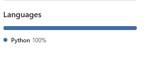
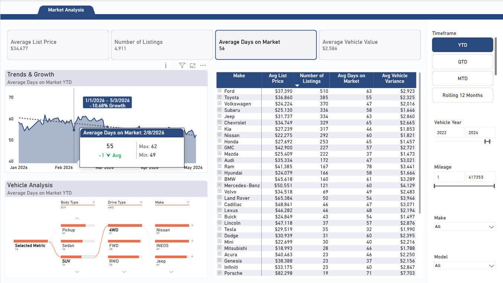
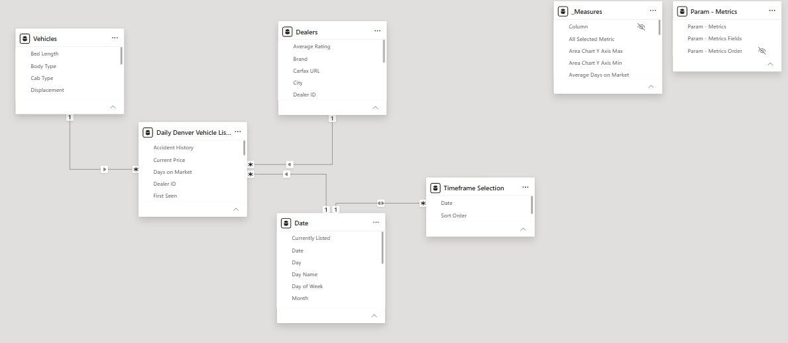

# Denver Vehicle Listings — Lakehouse Pipeline

An end-to-end data engineering pipeline that ingests daily vehicle listings for the Denver metro area, transforms them through a medallion lakehouse architecture in Databricks, and surfaces analytics-ready data in Power BI.


## Overview

This project collects ~50 pages of vehicle listing data daily from a third-party vehicle listings API, landing it in a bronze layer and progressively refining it through silver and gold schemas. The gold layer feeds a Power BI report for market analysis — pricing trends, dealer comparisons, inventory health, and vehicle history insights.

### Key Features

- **Medallion Architecture** — Bronze → Silver → Gold layering with Delta Lake and Unity Catalog
- **Incremental & Full Load** — Parameterized notebooks support both modes; a SQL delimiter pattern (`-- << INCREMENTAL >> --`) keeps full and incremental logic in a single file
- **Delta Lake MERGE** — Upsert logic with schema evolution for deduplication at every layer
- **100+ Derived Columns** — Complex parsing of nested JSON arrays (price history, ownership, service records, accident history) and derived metrics (days on market, value variance, dealer brand classification)
- **ETL Logging** — Every run writes to an `etl_run_log` Delta table with row counts, timestamps, and status
- **Concurrent Execution** — Silver and gold transformations use `ThreadPoolExecutor` to process tables in parallel

## Architecture

```
  Third-Party API ──▶ Bronze (raw) ──▶ Silver (cleaned) ──▶ Gold (analytics) ──▶ Power BI
                       MERGE /          SQL transforms       Dedup / Agg
                       OVERWRITE        100+ columns         3 tables
```

See [docs/architecture.md](docs/architecture.md) for the full architecture breakdown, layer details, and incremental strategy.

## Project Structure

```
denver-vehicle-listings/
├── notebooks/
│   ├── etl/
│   │   ├── dvl_bronze_load.py          # API ingestion → bronze Delta table
│   │   ├── dvl_bronze_to_silver.py     # Bronze → silver transformation driver
│   │   └── dvl_silver_to_gold.py       # Silver → gold transformation driver
│   └── utilities/                      # Shared helper notebooks
├── queries/
│   ├── silver/
│   │   └── denver_vehicle_listings.sql # Silver transformation (CTEs, 100+ columns)
│   └── gold/
│       ├── daily_listings.sql          # Full listing history
│       ├── dealers.sql                 # Dealer dimension (dedup)
│       └── vehicles.sql               # Vehicle dimension (dedup)
├── reports/
│   ├── measures.dax                    # All 20 DAX measures from the semantic model
│   └── screenshots/                    # Power BI report screenshots
├── docs/
│   └── architecture.md                 # Detailed architecture documentation
├── .gitignore
└── README.md
```

## Tech Stack

| Layer           | Technology                                 |
|-----------------|--------------------------------------------|
| **Ingestion**   | Python (`requests`, `pandas`)              |
| **Processing**  | PySpark, Spark SQL                         |
| **Storage**     | Delta Lake (Unity Catalog)                 |
| **Orchestration** | Databricks Jobs (parameterized notebooks)|
| **Visualization** | Power BI                                |

## How It Works

### 1. Bronze — Raw Ingestion (`dvl_bronze_load.py`)
Fetches paginated JSON from the vehicle listings API, flattens nested structures with `pd.json_normalize`, assigns a composite `unique_id`, and writes to the bronze Delta table via `MERGE` or full `OVERWRITE`.

### 2. Silver — Transformation (`dvl_bronze_to_silver.py` + SQL)
Loads the silver SQL query from `queries/silver/`, which applies:
- Type casting and null handling across all columns
- Group-level fill for missing dealer ratings and MPG values
- Composite `vehicle_id` generation from vehicle attributes
- Complex array parsing for price, owner, service, and accident histories
- Dealer brand classification via pattern matching on dealer name
- Derived metrics: `days_on_market`, `value_variance`, `value_variance_groups`

### 3. Gold — Analytics-Ready (`dvl_silver_to_gold.py` + SQL)
Produces three focused tables:
- **`daily_listings`** — Every listing snapshot per retrieval date
- **`dealers`** — One row per dealer (latest record wins via `ROW_NUMBER`)
- **`vehicles`** — One row per vehicle (latest record wins via `QUALIFY`)

### 4. Power BI (`reports/measures.dax`)
The gold tables are consumed by a Power BI semantic model with 7 tables and 20 DAX measures organized into:
- **Listing Metrics** — Core KPIs: `Number of Listings`, `Average List Price`, `Average Days on Market`, `Average Vehicle Value`, plus a dynamic `Selected Metric` switcher driven by a parameter slicer
- **Area Chart CF** — Dynamic axis bounds, growth percentage calculations, and midpoint label positioning for the trend area chart
- **Conditional Formatting** — Dynamic subtitles, tooltip comparisons vs. overall average with directional arrows (UNICHAR), and color-coded conditional formatting

## Power BI Report

### Market Analysis Dashboard


The report is built around a **field parameter** (`Param - Metrics`) that drives the entire page. Selecting a different KPI card switches the active metric across all visuals simultaneously — the area chart, matrix table, decomposition tree, and tooltip all respond to the selection.

**Selecting "Average Days on Market":**



#### Report Highlights
- **Tile Slicer as KPI Cards** — The four metric cards at the top are a tile slicer connected to the field parameter. Selecting one changes the active metric across the entire page while also displaying the current value — making the slicer itself informative rather than just a control
- **Field Parameter** — A `Param - Metrics` field parameter powers the `Selected Metric` DAX measure, which uses `SWITCH` on `SELECTEDVALUE` to dynamically return the correct calculation. A matching dynamic format string expression ensures currency metrics display as `$#,0` and count metrics as `#,0`
- **Growth Annotation** — The area chart calculates period-over-period growth and positions the label at the midpoint of the selected date range using `DATEDIFF` and a median-date calculation
- **Custom Tooltip** — Hovering over the area chart shows the metric value, min/max for the period, and a comparison to the overall average with a directional arrow (▲/▼) and conditional color formatting (red above average, green below)
- **Decomposition Tree** — The Vehicle Analysis section uses a decomposition tree to drill into what drives the selected metric across Body Type, Drive Type, and Make
- **Dynamic Timeframe** — YTD, QTD, MTD, and Rolling 12 Months selections via a `Timeframe Selection` table with bidirectional filtering on the Date table

### Data Model


The semantic model follows a star schema with `Daily Denver Vehicle Listings` as the fact table, `Dealers` and `Vehicles` as dimension tables, and a `Date` table for time intelligence. The `_Measures` table holds all 20 DAX measures, and `Param - Metrics` / `Timeframe Selection` are disconnected tables that drive report interactivity.

## Parameters

The pipeline is driven by three Databricks widget parameters:

| Parameter             | Type    | Description                                           |
|-----------------------|---------|-------------------------------------------------------|
| `initLoad`            | `true/false` | `true` = full overwrite; `false` = incremental   |
| `incrementalInterval` | integer | Days to look back for incremental loads               |
| `run_id`              | string  | Unique run identifier for ETL logging                 |

## Setup

> **Note:** This project runs in Databricks. The notebooks are stored as `.py` files formatted for Databricks import (cell separators: `# COMMAND ----------`).

1. Import the notebooks into your Databricks workspace
2. Create the catalog and schemas in Unity Catalog:
   ```sql
   CREATE CATALOG IF NOT EXISTS analytics_lakehouse;
   CREATE SCHEMA IF NOT EXISTS analytics_lakehouse.bronze;
   CREATE SCHEMA IF NOT EXISTS analytics_lakehouse.silver;
   CREATE SCHEMA IF NOT EXISTS analytics_lakehouse.gold;
   ```
3. Upload the SQL query files to `/Workspace/<your-path>/Queries/`
4. Configure a Databricks Job to run the three notebooks in sequence with the appropriate parameters
5. Connect Power BI to the gold-layer tables via the Databricks SQL connector
